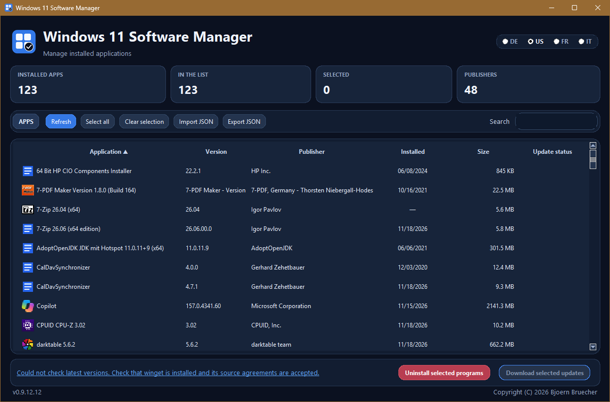
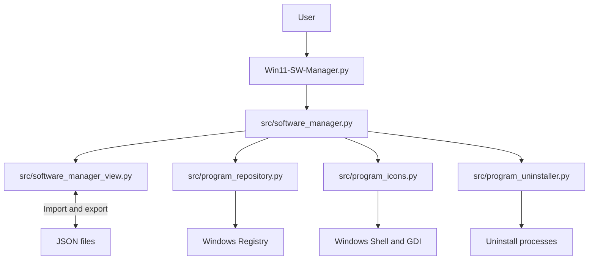

# Win11-SW-Manager

[](https://github.com/BjoernBruecher/Win11-SW-Manager/releases)

A small Windows utility for overview and management of installed programs on Windows 11.

## Download

[Download the latest application](https://github.com/BjoernBruecher/Win11-SW-Manager/releases/latest/download/Win11-SW-Manager.exe)
or download its [SHA-256 checksum](https://github.com/BjoernBruecher/Win11-SW-Manager/releases/latest/download/Win11-SW-Manager.exe.sha256)
from the same release.

To verify a downloaded executable in PowerShell:

```powershell
$expected = ((Get-Content .\Win11-SW-Manager.exe.sha256 -Raw).Trim() -split '\s+')[0]
$actual = (Get-FileHash .\Win11-SW-Manager.exe -Algorithm SHA256).Hash
if ($actual -ne $expected) { throw "SHA-256 checksum mismatch" }
```

## Overview

This project reads installed applications from the Windows registry, displays them in a clear GUI, and allows you to:

- Search for programs by name or vendor
- Sort by any table column by clicking its heading
- View the program name, version, publisher, installation date, and estimated size
- Check the latest available version for catalog-matched programs using winget
- See a green "Latest" indicator for programs already at the latest version
- Download selected update installers to the Downloads folder, with at most two downloads at a time
- See each program's icon when Windows provides one
- Select multiple entries
- Show the main window before the initial system scan and populate the table afterward
- See the live number of selected programs marked for uninstall
- Track progress while reading and updating the program list
- Track successful uninstallations and remaining programs with a progress bar for multi-program uninstalls
- Export the program list as JSON
- Import a previously exported JSON file
- Uninstall selected programs with safety checks
- Allow only one application instance across Windows sessions
- Select German (DE), English (US), French (FR), or Italian (IT) using the radio buttons
- Show the application icon in the window and packaged executable, for use on shortcuts
- Show the application version in the lower-left corner of the window
- Request administrator privileges at startup
- Adapt the initial window height to the available screen space so the version and copyright notice are visible

## Screenshot



## Features

- Lists all installed applications from:
  - `HKLM\SOFTWARE\Microsoft\Windows\CurrentVersion\Uninstall`
  - `HKLM\SOFTWARE\WOW6432Node\Microsoft\Windows\CurrentVersion\Uninstall`
  - `HKCU\SOFTWARE\Microsoft\Windows\CurrentVersion\Uninstall`
- Real-time filtering through the search field
- Total count of visible and available programs
- A modern dark dashboard with a rounded search field, cards, and table panels, plus pill-shaped controls
- Registry-provided app icons with a built-in fallback
- Safety mechanisms during uninstallation:
  - Prevents automatic execution of MSI/silent uninstallation commands without verification
  - Blocks script-based commands such as `.bat`, `.cmd`, `.ps1`, and `.vbs` for security reasons
  - Displays warnings and confirmation prompts

## Requirements

- Windows 11 (or a compatible Windows system with the same registry structure)
- Python 3.9+
- Tkinter (usually included with Python installations)
- PyInstaller (only required to build the executable)

## Run the application

1. Install Python if it is not already available.
2. Clone the repository or download the files.
3. Run the following command in a terminal:

```bash
python Win11-SW-Manager.py
```

Windows displays a User Account Control (UAC) prompt at startup. The
application starts only after administrator permission is granted; canceling
the prompt exits without opening the application.

## Build a standalone executable

Install PyInstaller and run the PowerShell build script:

```powershell
python -m pip install pyinstaller
.\build_exe.ps1
```

The script builds a single-file, windowed executable at
`dist\Win11-SW-Manager.exe`. You can select a different Python executable with
`.\build_exe.ps1 -PythonCommand C:\Path\To\python.exe`.
The executable includes the application icon, which Windows can also use for
shortcuts to the program. The build script adds Windows file properties from
`src\version.py`, including file and product versions, description, language,
copyright, and original filename. Windows prompts for administrator permission whenever
the executable starts.

## Create a release

The application version is defined in `src/version.py`. After committing all
other changes and ensuring the worktree is clean, create and publish a release
with:

```powershell
.\release.ps1 -Version 1.0.0
```

The supplied version must contain exactly three dot-separated numbers, for
example `1.0.0`. The script prints the current version as a reference and
rejects a lower or malformed version prefix. If `-Version` is omitted, the
script prompts for it. The script sets the fourth number to the total Git
commit count at the release commit, builds the executable, calculates its
SHA-256 checksum, commits the version change,
creates and pushes the matching tag, and publishes a GitHub release with the
executable and checksum file attached. It requires Git, PyInstaller, GitHub
CLI (`gh`), and an authenticated GitHub CLI session.

## Usage notes

- Create a current backup of your system before using this program, especially before uninstalling software.
- The application uses the Windows registry and the uninstall strings of installed applications.
- On Windows startup, the interface selects the supported language matching the first language in the user's Windows language list. If it is unsupported or unavailable, English (US) is selected; the radio buttons can be used to change it.
- Version status uses the configured winget sources and exact application-name matching. Matching programs at their latest version show a green **Latest** indicator; programs with an available update show an orange, clickable **↑ latest-version** value in the table. Select one or more updateable programs to download their installers to the Downloads folder; no more than two downloads run at the same time. Downloaded installers are not run automatically. Unmatched programs remain blank. Version lookup runs in the background, and installed programs still load if winget or its sources are unavailable. Winget source agreements must already be accepted; the application does not accept them automatically.
- Winget may send installed application names to its configured sources during lookup.
- The interface translations are stored in UTF-8 JSON files under `src/locales/`. Keep the keys and `{placeholders}` consistent between languages.
- Import and export dialogs suggest a JSON filename in the currently selected language.
- Installation dates and estimated sizes are read from the registry when available. Size values are estimates reported by each installer.
- Some programs may require administrator rights to uninstall successfully.
- A confirmation prompt is shown before uninstalling. Unsafe or script-based uninstall commands are not executed automatically.

## Troubleshooting winget source issues

### 1. Accept the source agreements

Open PowerShell or Windows Terminal. Administrator privileges are normally not
required.

Run:

```powershell
winget source update --accept-source-agreements
```

This accepts the agreements for winget's package sources and updates them.

### 2. Check whether it worked

Run:

```powershell
winget source list
```

You should see sources such as:

- `msstore`
- `winget`

Then run:

```powershell
winget upgrade
```

If it lists available updates, winget is working.

If you still get an error, reset the default sources and update them again:

```powershell
winget source reset --force
winget source update --accept-source-agreements
```

Then run `winget upgrade` again.

> **Important:** Accepting source agreements means agreeing to the terms for
> accessing repositories such as Microsoft's Store catalog and the community
> package repository. This is different from accepting individual software
> licenses.

## Project structure

```text
Win11-SW-Manager/
├── README.md
├── CLAUDE.md
├── assets/
│   ├── program.ico
│   └── screenshot.png
├── .github/
│   └── skills/
│       ├── windows-software-manager/
│       │   └── SKILL.md
│       ├── rounded-gui/
│       │   └── SKILL.md
│       └── update-readme-screenshot/
│           └── SKILL.md
├── build_exe.ps1
├── release.ps1
├── Win11-SW-Manager.py
├── src/
│   ├── __init__.py
│   ├── version.py
│   ├── software_manager.py
│   ├── software_manager_view.py
│   ├── program_repository.py
│   ├── program_uninstaller.py
│   ├── program_icons.py
│   ├── single_instance.py
│   ├── localization.py
│   ├── rounded_widgets.py
│   └── locales/
│       ├── de.json
│       ├── us.json
│       ├── fr.json
│       └── it.json
└── <locale-specific JSON filename>   (generated during export)
```

## Architecture



The root launcher starts the controller. The controller coordinates the Tkinter
view with registry, icon, and uninstall services in `src/`.

## Example: export to JSON

Once the app is running, the complete list can be saved as a JSON file. That file can then be imported again in another session to reuse the list.

## License

This project was created without a specific license agreement. Please use it according to the rules of your operating environment.

Copyright (C) 2026 Bjoern Bruecher.
