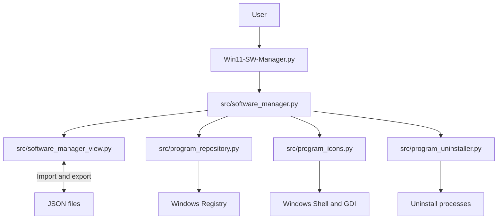

# Win11-SW-Manager

A small Windows utility for overview and management of installed programs on Windows 11.

## Overview

This project reads installed applications from the Windows registry, displays them in a clear GUI, and allows you to:

- Search for programs by name or vendor
- Sort by any table column by clicking its heading
- View the program name, version, publisher, installation date, and estimated size
- See each program's icon when Windows provides one
- Select multiple entries
- Show the main window before the initial system scan and populate the table afterward
- See the live number of selected programs marked for uninstall
- Track progress while reading and updating the program list
- Track successful uninstallations and remaining programs with a progress bar
- Export the program list as JSON
- Import a previously exported JSON file
- Uninstall selected programs with safety checks
- Allow only one application instance across Windows sessions
- Select German (DE), English (US), French (FR), or Italian (IT) using the radio buttons

## Features

- Lists all installed applications from:
  - `HKLM\SOFTWARE\Microsoft\Windows\CurrentVersion\Uninstall`
  - `HKLM\SOFTWARE\WOW6432Node\Microsoft\Windows\CurrentVersion\Uninstall`
  - `HKCU\SOFTWARE\Microsoft\Windows\CurrentVersion\Uninstall`
- Real-time filtering through the search field
- Total count of visible and available programs
- A modern dark dashboard with a rounded search field, cards, and table panels, plus pill-shaped controls
- Registry-provided app icons with a built-in fallback
- Safety mechanisms during uninstallation:
  - Prevents automatic execution of MSI/silent uninstallation commands without verification
  - Blocks script-based commands such as `.bat`, `.cmd`, `.ps1`, and `.vbs` for security reasons
  - Displays warnings and confirmation prompts

## Requirements

- Windows 11 (or a compatible Windows system with the same registry structure)
- Python 3.9+
- Tkinter (usually included with Python installations)
- PyInstaller (only required to build the executable)

## Run the application

1. Install Python if it is not already available.
2. Clone the repository or download the files.
3. Run the following command in a terminal:

```bash
python Win11-SW-Manager.py
```

## Build a standalone executable

Install PyInstaller and run the PowerShell build script:

```powershell
python -m pip install pyinstaller
.\build_exe.ps1
```

The script builds a single-file, windowed executable at
`dist\Win11-SW-Manager.exe`. You can select a different Python executable with
`.\build_exe.ps1 -PythonCommand C:\Path\To\python.exe`.

## Usage notes

- The application uses the Windows registry and the uninstall strings of installed applications.
- At startup, the interface selects the supported language matching the operating system locale. If it is unsupported, German is selected; the radio buttons can be used to change it.
- The interface translations are stored in UTF-8 JSON files under `src/locales/`. Keep the keys and `{placeholders}` consistent between languages.
- Import and export dialogs suggest a JSON filename in the currently selected language.
- Installation dates and estimated sizes are read from the registry when available. Size values are estimates reported by each installer.
- Some programs may require administrator rights to uninstall successfully.
- A confirmation prompt is shown before uninstalling. Unsafe or script-based uninstall commands are not executed automatically.

## Project structure

```text
Win11-SW-Manager/
├── README.md
├── CLAUDE.md
├── .github/
│   └── skills/
│       ├── windows-software-manager/
│       │   └── SKILL.md
│       └── rounded-gui/
│           └── SKILL.md
├── build_exe.ps1
├── Win11-SW-Manager.py
├── src/
│   ├── __init__.py
│   ├── software_manager.py
│   ├── software_manager_view.py
│   ├── program_repository.py
│   ├── program_uninstaller.py
│   ├── program_icons.py
│   ├── single_instance.py
│   ├── localization.py
│   ├── rounded_widgets.py
│   └── locales/
│       ├── de.json
│       ├── us.json
│       ├── fr.json
│       └── it.json
└── <locale-specific JSON filename>   (generated during export)
```

## Architecture



The root launcher starts the controller. The controller coordinates the Tkinter
view with registry, icon, and uninstall services in `src/`.

## Example: export to JSON

Once the app is running, the complete list can be saved as a JSON file. That file can then be imported again in another session to reuse the list.

## License

This project was created without a specific license agreement. Please use it according to the rules of your operating environment.

Copyright (C) 2026 Bjoern Bruecher.
